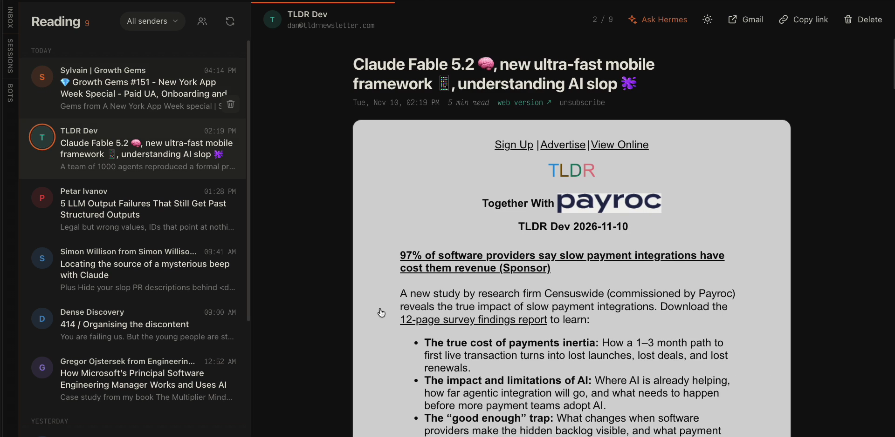

# Reading for Hermes

**Your newsletters, out of the inbox and into a reader built for them.**

Newsletters are the good part of email, and the inbox is the worst place to read them. Reading
moves the senders you pick into one Gmail label and gives that label a calm, fast reader: a page in
Hermes Desktop, and a web app on your phone. Hermes reads along with you.




## Why it is different

- **Setup finds your newsletters for you.** Connect Gmail, and Reading scans your inbox for
  mailing-list mail and ticks the ones that look like newsletters. Untick the receipts, press
  one button, done. Add or remove a sender by hand at any time.
- **Gmail does the moving, not a server.** Reading writes native Gmail filters. New issues skip
  the inbox even when Hermes is off, and your mail never passes through a third party. To undo
  everything, remove the filters.
- **Ask Hermes about any issue.** One button opens a chat with the newsletter attached. Ask
  for the gist, argue with it, turn it into a task, save it to your notes. In any chat, type
  `@newsletter:` to attach one by subject.
- **Unsubscribe in one tap.** Reading uses the sender's one-click unsubscribe (RFC 8058), or
  sends the unsubscribe email for you, and stops routing the sender.
- **A reader, not a mail client.** Swipe or press `j`/`k` through issues, `d` to delete with
  Undo, `t` for dark or original colors (remembered per sender). Emails that ship their own dark
  design keep it.
- **Digests with your own agent.** `hermes reading export --since 24h` gives a cron job the day's
  newsletters as Markdown. The bundled skill shows Hermes how to turn them into a text digest or
  an audio brief.
- **Your Google client, Hermes holds the token.** Reading talks to the Gmail API with an OAuth
  client that you own. Hermes runs the sign-in and keeps and refreshes the token; Reading never
  sees it. No telemetry. Public Hermes APIs only.

## Install

```bash
hermes plugins install Nj07r/hermes-reading
hermes plugins enable reading
```

The install asks for `READING_GOOGLE_CLIENT_ID` and `READING_GOOGLE_CLIENT_SECRET`. Press Enter
to skip them for now: setup sets them. Restart the gateway. In Hermes Desktop, open
**Settings > Plugins** and switch on **Reading**. **Reading** appears in the sidebar, under Archive.

## Set up

Once, about 3 minutes:

1. **Create a Google OAuth client.** It is free. Enable the
   [Gmail API](https://console.cloud.google.com/apis/library/gmail.googleapis.com), set up the
   [consent screen](https://console.cloud.google.com/auth/overview) (External, with yourself as a
   test user), and [create a client](https://console.cloud.google.com/auth/clients) of type
   **Desktop app**. Download its JSON.
2. **Connect Gmail** from a terminal:

   ```bash
   hermes reading setup --client ~/Downloads/client_secret_....json
   ```

   This saves the client id and secret in your profile's `.env` (with `hermes config set`), then
   runs `hermes auth add reading:google`, which opens the Google sign-in. Hermes stores the grant.
   No browser on this machine? Add `--no-browser`.
3. **Pick newsletters.** The command lists the newsletters it found. Or open **Reading** in the
   Desktop sidebar: it moves on by itself after the sign-in, and you tick the newsletters and press
   **Move**.

Or ask Hermes: "set up Reading for me". The bundled skill knows the steps. Hermes cannot run the
sign-in for you: `hermes auth add` runs only in your own terminal.

To sign out: `hermes auth logout reading:google`.

## Use it

| Where | How |
|---|---|
| Hermes Desktop | **Reading** in the sidebar: the list and the email side by side in the main area. |
| Browser and phone | `http://<your dashboard>/dashboard-plugins/reading/open.html`. On a phone, add it to the home screen. |
| Any chat | `@newsletter:` and a few letters of the subject. |
| Terminal and cron | `hermes reading list`, `export`, `senders`, `add`, `remove`, `unsubscribe`. |

Keys in the reader: `j` `k` move, `d` delete, `z` undo, `a` ask Hermes, `s` senders, `c` copy
link, `o` open in Gmail, `t` colors, `r` refresh, `?` all keys.

## Coming from Meco

`hermes reading import-label <Meco's label>` moves its mail into Reading and adds its senders.
Then disconnect Meco and run `hermes reading sync` once, in case Meco moved mail back to the
inbox.

## Documentation

- [Reference](docs/reference.md): commands, settings, files, Gmail scopes, page API.
- [About Reading](docs/about-reading.md): how the parts work together, and why.

## Privacy

What Reading does, before you install it:

- **Network:** the Gmail API (`gmail.googleapis.com`), through Hermes's
  `credentialed_provider_request`. When you press **Unsubscribe**: a one-click POST to the
  sender's unsubscribe address, or an unsubscribe email sent from your Gmail account.
  Nothing else, and no telemetry.
- **Gmail changes:** it creates the label, writes and deletes its own Gmail filters, moves the
  routed senders' mail out of the inbox, marks emails as read when you open them, and moves
  emails to the Trash when you delete them.
- **Credentials:** none stored by Reading. The Google client id and secret are `.env` variables
  that Hermes reads. Hermes stores and refreshes the sign-in in its own `auth.json`.
- **Files:** only its own `HERMES_HOME/reading/` (the sender list and the ids of its filters).
- **Shell:** `hermes reading setup` runs `hermes config set` and `hermes auth add`, in your
  terminal only, without the parent's auto-approve or YOLO variables.
- **Model provider:** the `@newsletter:` reference and **Ask Hermes** send the newsletter text to
  your model provider, like any text you paste into a chat.

## Development

```bash
git clone https://github.com/Nj07r/hermes-reading && cd hermes-reading
ln -s "$PWD" ~/.hermes/plugins/reading
~/.hermes/hermes-agent/venv/bin/python -m unittest discover -s tests
hermes plugins validate . && hermes plugins doctor . --ci
```

`page.html` and `reading_core.py` reload on each request: no gateway restart needed. Changes to
`dashboard/plugin_api.py` or `__init__.py` need one. After a change to `desktop/plugin.js`, reload
Desktop with `cmd+shift+r`.

MIT license.
